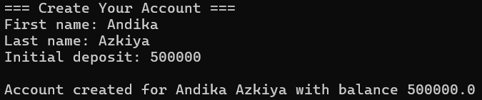
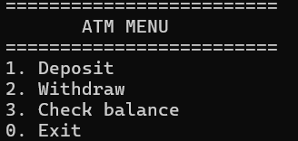
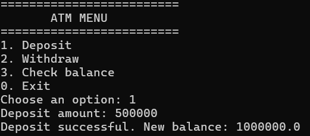
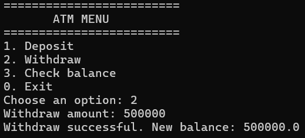
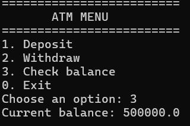
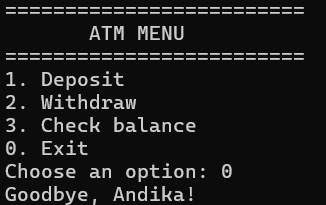

## Program Features

When the program starts, the user is asked to enter a first name and last name to create a new customer. That customer is automatically given an initial balance of `50000`.

Once the account is created, the program displays the main menu with the following options:

1. Deposit
2. Withdraw
3. Check Balance
4. Exit

## Screenshots

### 1. Customer Name Input

Screenshot of the program asking for the customer's first and last name.



### 2. Main Menu

Screenshot of the main menu being displayed.



### 3. Deposit

Screenshot of selecting the **Deposit** menu and entering an amount.



### 4. Withdraw

Screenshot of selecting the **Withdraw** menu and entering an amount.



### 5. Check Balance and Exit

Screenshot of selecting **Check Balance** and selecting **Exit**.





## How to Run

Make sure Java is installed on your computer.

Compile all Java files:

```bash
javac *.java
```

Run the program through the main class (`Main`):

```bash
java Main
```